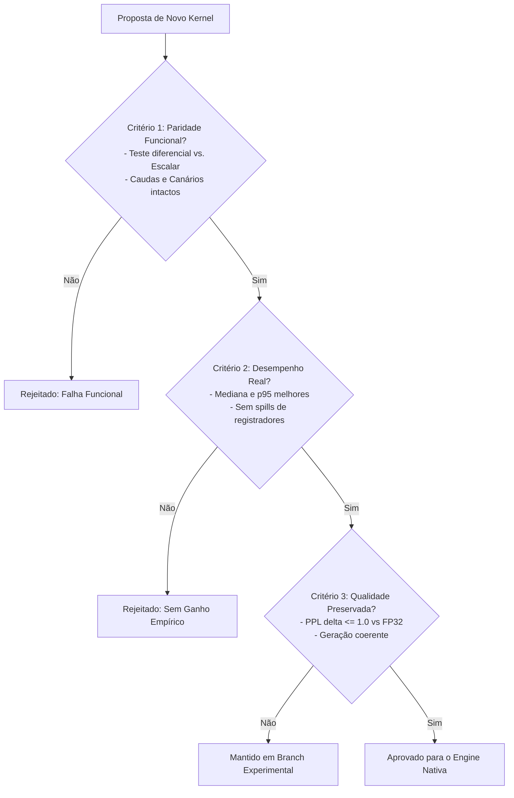

# Nativa Runtime: Especificação Técnica Q4x4 Lean & Protocolo de Gatekeeping

## 1. Contexto e Objetivo
Este documento formaliza o congelamento do kernel **Q4x4 Lean** (`mlp_gate_up_swiglu_q4x4_tiled`) como a referência de produção padrão do runtime **Nativa** para modelos densos pré-treinados (ex.: Qwen2.5, Qwen3, LLaMA, Mistral).

Ele estabelece as métricas oficiais de referência no hardware alvo, corrige inconsistências de nomenclatura de precisão e define o protocolo de aceitação (*Gatekeeping Criteria*) obrigatório para avaliar qualquer proposta de novo kernel (incluindo variantes ternárias ou com desempacotamento de trits).

---

## 2. Reconciliação Matemática de Formato e Volumes de Memória

### 2.1. Estrutura do Bloco `BlockQ4x4`
O formato proprietário `.natq4` emprega agrupamento de 4 linhas contíguas para amortizar o custo de escalas e otimizar o alinhamento de carregamento SIMD de 128 bits:

```c
#pragma pack(push, 1)
typedef struct {
    uint16_t scale[4]; // 8 bytes: 4 escalas BF16 (1 por linha)
    uint8_t  qs[64];   // 64 bytes: nibbles empacotados (16 bytes = 32 pesos por linha)
} BlockQ4x4;           // Exatamente 72 bytes por bloco (128 pesos totais)
#pragma pack(pop)
```

* **Pesos representados por bloco:** $4 \text{ linhas} \times 32 \text{ colunas} = 128 \text{ pesos}$.
* **Densidade de memória efetiva:**
  $$\frac{72 \text{ bytes}}{128 \text{ pesos}} = 0{,}5625 \text{ bytes/peso} = 4{,}50 \text{ bits/peso}$$

### 2.2. Esclarecimento Rigoroso de Precisões e Dtypes
Para evitar ambiguidades entre precisão de ponto flutuante e densidade de pesos:
* **FP32:** Ponto flutuante de precisão simples (IEEE 754), **32 bits/peso** (4 bytes/peso).
* **FP16 / BF16:** Ponto flutuante de meia precisão / Bfloat16, **16 bits/peso** (2 bytes/peso). Usado nas escalas por bloco e biases.
* **Q8_0 (`BlockQ8`):** Vetor de ativação quantizado, **8 bits/peso** + escala FP32 por bloco de 32 elementos ($36 \text{ bytes}/32 = 9 \text{ bits/peso}$).
* **Q4x4 (`BlockQ4x4`):** Matriz de pesos quantizada, **4,50 bits/peso** (incluindo metadados).
* **Ternário 2-bit (`BlockTernary2bit4x4`):** Matriz ternária com 4 trits/byte, **2,50 bits/peso** (40 bytes para 128 pesos).
* **Ternário Canônico 5-trits:** Matriz com empacotamento compacto, **$\approx 1,85$ bits/peso** (incluindo escalas BF16).

### 2.3. Volume Físico no Bloco MLP ($M = 8960, K = 1536$)
Para o MLP do Qwen2.5-1.5B (duas matrizes lidas a cada token: $W_{gate}$ e $W_{up}$):
* $\text{Grupos de linhas } (M/4): 2240$
* $\text{Blocos por linha } (K/32): 48$
* $\text{Blocos por tensor}: 2240 \times 48 = 107.520 \text{ blocos}$
* **Tamanho de 1 tensor ($W_{gate}$ ou $W_{up}$):**
  $$107.520 \times 72 \text{ bytes} = 7.741.440 \text{ bytes} = 7{,}741 \text{ MB (decimais)} = 7{,}383 \text{ MiB (binários)}$$
* **Volume total transferido por token ($W_{gate} + W_{up}$):**
  $$2 \times 7.741.440 = \mathbf{15.482.880 \text{ bytes}} = \mathbf{15{,}483 \text{ MB (decimais)}} = \mathbf{14{,}766 \text{ MiB (binários)}}$$

---

## 3. Linha de Base Estável (Host Físico: Ivy Bridge x64)

### 3.1. Condições de Execução Padronizadas
* **Processador:** Intel Core Gen 3 (Ivy Bridge, 4 cores físicos, HT desativado para benchmark / 4 threads fixas).
* **Conjunto de Instruções:** SSE4.1, SSE4.2, AVX (256-bit FP). *Sem suporte a AVX2 ou FMA*.
* **Subsistema de Memória:** DDR3 dual-channel ($\approx 20{,}5 \text{ GB/s}$ observados em leitura contínua sintética).
* **Compilador:** MSVC x64 v19.29 (`/O2 /openmp /arch:AVX`).
* **OpenMP:** 4 threads, `schedule(static)`.

### 3.2. Medições Oficiais da Referência Q4x4 Lean (100 Amostras)
As medições foram colhidas com timer de alta resolução (`QueryPerformanceCounter`):

| Métrica | Leitura Pura da DRAM (*Stream Probe*) | Kernel Q4x4 Lean Completo (com SwiGLU) |
| :--- | :--- | :--- |
| **Latência Mediana** | **$0{,}910 \text{ ms}$** | **$0{,}991 \text{ ms}$** |
| **Latência Média $\pm$ DesvPad** | $0{,}999 \pm 0{,}456 \text{ ms}$ | $1{,}179 \pm 0{,}591 \text{ ms}$ |
| **Latência Mínima / Máxima** | $0{,}747 \text{ ms}$ / $4{,}108 \text{ ms}$ | $0{,}849 \text{ ms}$ / $4{,}098 \text{ ms}$ |
| **Vazão de Leitura Efetiva** | $17{,}02 \text{ GB/s}$ | $15{,}63 \text{ GB/s}$ |

> [!NOTE] Reconciliação do Diagnóstico de Banda
> A comparação direta no mesmo hardware e mesmo particionamento de threads mostra que o tempo gasto puramente para transferir os $15{,}48 \text{ MB}$ de pesos da DRAM ($0{,}910 \text{ ms}$) corresponde a **$91{,}8\%$** do tempo de execução do kernel completo ($0{,}991 \text{ ms}$). O overhead adicional da CPU executando multiplicações inteiras, conversões BF16, somas e a função de ativação SwiGLU é de apenas **$8{,}2\%$** ($0{,}081 \text{ ms}$).

---

## 4. Análise Crítica dos Modelos Ternários (Lições Aprendidas)

1. **A Armadilha do Desempacotamento de 5 trits/byte:**
   Embora o BitNet b1.58 canônico atinja alta densidade teórica ($\approx 1{,}85 \text{ bits/peso}$), o desempacotamento serial de 5 trits via tabela de consulta (LUT) em CPU consome **$4{,}309 \text{ ms}$** por camada MLP. Isso torna a execução **$4\times$ mais lenta** do que ler os pesos Q4 da memória.
2. **O Desempenho do Formato 2-bit/trit:**
   O empacotamento em potências de dois (4 trits/byte, 2 bits por peso) elimina o custo de decodificação via instruções SIMD simples (`_mm_and_si128` e `_mm_srli_epi16`), atingindo mediana de **$0{,}274 \text{ ms}$** ($3{,}61\times$ de ganho de velocidade).
3. **A Barreira de Qualidade (PTQ Zero-Shot vs. Treinamento Nativo):**
   A quantização ternária direta (*Post-Training Quantization*) de modelos densos já treinados (Qwen2.5) destrói as distribuições de pesos e ativações (PPL saltou de 54 para $> 1.000.000$, gerando colapso de repetição). O formato ternário exige checkpoints **nativamente treinados ou destilados em 1.58 bits**.

---

## 5. Protocolo de Gatekeeping para Novos Kernels

Para preservar a estabilidade e a qualidade do runtime Nativa, qualquer novo kernel proposto (inclusive variantes ternárias, kernels INT3/INT2 ou reestruturações de tiling) deve cumprir **três critérios obrigatórios** antes de ser promovido ao motor principal:



### Critério 1: Paridade Funcional e Testes de Cauda
* **Ground Truth Independente:** Erro absoluto nulo ($\Delta = 0{,}000000$) contra a referência escalar pura nos mesmos formatos e representações numéricas.
* **Cenários Limítrofes:** Validação compulsória com 4 cenários (zeros, saturação $\pm 40{,}0$, extremos de quantização $-128, +127$ e aleatórios determinísticos).
* **Tratamento de Caudas:** Suporte estrito a dimensões não múltiplas do tile ($rows \% 4 \ne 0$ e $cols \% 32 \ne 0$) sem vazamentos de memória ou escritas fora do buffer (verificado por sentinelas de memória `0xDEADBEEF` / `NaN`).

### Critério 2: Desempenho Reproduzível em Condições Equivalentes
* O benchmark deve medir **latência mediana, mínima, máxima e desvio padrão** sobre pelo menos 100 iterações em regime de regime térmico estabilizado (*warmup* prévio).
* A comparação deve incluir o ciclo completo (leitura, desempacotamento de pesos, cálculo e ativação fundida).
* Não serão aceitos kernels que aumentem a pressão sobre registradores a ponto de gerar *spills* para a pilha no compilador de produção.

### Critério 3: Preservação de Qualidade e Perplexidade
* O modelo não pode sofrer degradação inaceitável de perplexidade no conjunto de validação:
  * Para modelos gerais de produção: o aumento de perda (*loss*) não pode exceder $+0{,}50$ em relação ao baseline de referência.
  * O modelo deve demonstrar preservação de gramática, coerência lógica e ausência de loops infinitos de tokens em avaliações de geração (*greedy decoding* e *sampling*).
