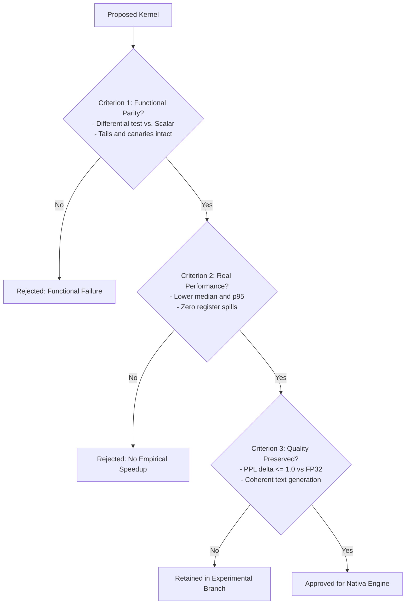

# Nativa Runtime: Q4x4 Lean Technical Specification & Gatekeeping Protocol

## 1. Context and Objective
This document formalizes the freeze of the **Q4x4 Lean** kernel (`mlp_gate_up_swiglu_q4x4_tiled`) as the standard production reference of the **Nativa** runtime for pre-trained dense LLMs (e.g., Qwen2.5, Qwen3, LLaMA, Mistral).

It establishes official baseline metrics on the target hardware, clarifies precision nomenclature, and defines mandatory acceptance criteria (*Gatekeeping Criteria*) to evaluate any future kernel proposals (including ternary or packed-trit variants).

---

## 2. Mathematical Reconciliation of Format and Memory Footprint

### 2.1. `BlockQ4x4` Block Structure
The proprietary `.natq4` format groups 4 contiguous rows together to amortize scale overhead and optimize 128-bit SIMD alignment:

```c
#pragma pack(push, 1)
typedef struct {
    uint16_t scale[4]; // 8 bytes: 4 BF16 scales (1 per row)
    uint8_t  qs[64];   // 64 bytes: packed nibbles (16 bytes = 32 weights per row)
} BlockQ4x4;           // Exactly 72 bytes per block (128 total weights)
#pragma pack(pop)
```

* **Weights per block:** $4 \text{ rows} \times 32 \text{ columns} = 128 \text{ weights}$.
* **Effective memory density:**
  $$\frac{72 \text{ bytes}}{128 \text{ weights}} = 0.5625 \text{ bytes/weight} = 4.50 \text{ bits/weight}$$

### 2.2. Rigorous Clarification of Precisions and Dtypes
To prevent ambiguity between floating-point precision and weight density:
* **FP32:** Single-precision IEEE 754 floating point, **32 bits/weight** (4 bytes/weight).
* **FP16 / BF16:** Half-precision floating point / Bfloat16, **16 bits/weight** (2 bytes/weight). Used for per-block scales and biases.
* **Q8_0 (`BlockQ8`):** Quantized activation vector, **8 bits/weight** + FP32 scale per 32-element block ($36 \text{ bytes}/32 = 9 \text{ bits/weight}$).
* **Q4x4 (`BlockQ4x4`):** Quantized weight matrix, **4.50 bits/weight** (including scale metadata).
* **2-bit Ternary (`BlockTernary2bit4x4`):** Ternary matrix packed at 4 trits/byte, **2.50 bits/weight** (40 bytes for 128 weights).
* **Canonical 5-trits Ternary:** Compact base-3 packing, **$\approx 1.85$ bits/weight** (including BF16 scales).

### 2.3. Physical Volume in the MLP Block ($M = 8960, K = 1536$)
For the Qwen2.5-1.5B MLP layer (two matrices traversed per generated token: $W_{gate}$ and $W_{up}$):
* $\text{Row groups } (M/4): 2240$
* $\text{Blocks per row } (K/32): 48$
* $\text{Blocks per tensor}: 2240 \times 48 = 107,520 \text{ blocks}$
* **Size of 1 tensor ($W_{gate}$ or $W_{up}$):**
  $$107,520 \times 72 \text{ bytes} = 7,741,440 \text{ bytes} = 7.741 \text{ MB (decimal)} = 7.383 \text{ MiB (binary)}$$
* **Total weight transfer per token ($W_{gate} + W_{up}$):**
  $$2 \times 7,741,440 = \mathbf{15,482,880 \text{ bytes}} = \mathbf{15.483 \text{ MB (decimal)}} = \mathbf{14.766 \text{ MiB (binary)}}$$

---

## 3. Stable Production Baseline (Physical Host: Ivy Bridge x64)

### 3.1. Standardized Execution Environment
* **Processor:** Intel Core Gen 3 (Ivy Bridge, 4 physical cores, HT pinned / 4 static threads).
* **Instruction Set:** SSE4.1, SSE4.2, AVX (256-bit FP). *No AVX2, No FMA3*.
* **Memory Subsystem:** DDR3 dual-channel ($\approx 20.5 \text{ GB/s}$ observed sustained ceiling on synthetic read).
* **Compiler:** MSVC x64 v19.29 (`/O2 /openmp /arch:AVX`).
* **OpenMP:** 4 threads, `schedule(static)`.

### 3.2. Official Reference Measurements (100 Samples)
Measurements collected via high-resolution hardware timers (`QueryPerformanceCounter`):

| Metric | Pure DRAM Stream Probe | Full Fused Lean Q4x4 Kernel (with SwiGLU) |
| :--- | :--- | :--- |
| **Median Latency** | **$0.910 \text{ ms}$** | **$0.991 \text{ ms}$** |
| **Mean Latency $\pm$ StdDev** | $0.999 \pm 0.456 \text{ ms}$ | $1.179 \pm 0.591 \text{ ms}$ |
| **Min / Max Latency** | $0.747 \text{ ms}$ / $4.108 \text{ ms}$ | $0.849 \text{ ms}$ / $4.098 \text{ ms}$ |
| **Effective Memory Bandwidth** | $17.02 \text{ GB/s}$ | $15.63 \text{ GB/s}$ |

> [!NOTE] Reconciled Bandwidth Diagnostics
> Direct comparison under identical thread pinning shows that pure streaming of the $15.48 \text{ MB}$ weight matrices from DRAM ($0.910 \text{ ms}$) accounts for **$91.8\%$** of total execution time ($0.991 \text{ ms}$). Additional CPU overhead from integer multiply-accumulates, BF16 conversions, and SwiGLU activation totals only **$8.2\%$** ($0.081 \text{ ms}$).

---

## 4. Critical Assessment of Ternary Models (Lessons Learned)

1. **The 5-Trits-per-Byte Unpacking Trap:**
   While canonical BitNet b1.58 reaches high theoretical density ($\approx 1.85 \text{ bits/weight}$), serial lookup table (LUT) decoding on CPU costs **$4.309 \text{ ms}$** per MLP block. This makes execution **$4\times$ slower** than streaming Q4 weights from RAM.
2. **2-Bit-per-Trit SIMD Efficiency:**
   Power-of-two packaging (4 trits/byte, 2 bits per weight) enables single-cycle parallel SIMD extraction (`_mm_and_si128` and `_mm_srli_epi16`), achieving **$0.274 \text{ ms}$** median latency ($3.61\times$ real speedup in isolated microbenchmarks).
3. **The Quality Hurdle (Zero-Shot PTQ vs. Native Training):**
   Direct post-training quantization (PTQ) of pre-trained dense models (like Qwen2.5) down to 3 states ($\{-1, 0, +1\}$) causes catastrophic perplexity collapse (PPL jumps from 54 to $> 1,000,000$). The ternary pipeline must be reserved for models **natively trained or distilled in 1.58 bits**.

---

## 5. Gatekeeping Protocol for New Kernels

To safeguard runtime stability and inference quality, any proposed kernel (including ternary variants, INT3/INT2, or alternative tiling) must satisfy **three mandatory criteria** before promotion to the main engine:



### Criterion 1: Functional Parity & Tail Verification
* **Independent Ground Truth:** Zero absolute error ($\Delta = 0.000000$) against pure scalar reference implementation under identical numerical formulations.
* **Boundary Scenarios:** Compulsory validation across 4 regimes (zeros, saturation $\pm 40.0$, quantization extremes $-128, +127$, and deterministic pseudo-random).
* **Tail Support:** Strict handling of non-multiple dimensions ($rows \% 4 \ne 0$ and $cols \% 32 \ne 0$) with zero out-of-bounds writes or unwritten memory (audited via `0xDEADBEEF` / `NaN` canaries).

### Criterion 2: Reproducible Performance Under Equivalent Conditions
* Benchmarks must measure **median, min, max, and standard deviation** over at least 100 timed iterations preceded by thermal stabilization warmups.
* Comparisons must capture the complete execution cycle (memory transfer, weight unpacking, computation, and activation).
* Kernels that induce register spills to stack under the production compiler are rejected.

### Criterion 3: Quality and Perplexity Retention
* The model must not suffer unacceptable perplexity degradation on validation sets:
  * For general production models: Cross-Entropy loss increase must not exceed $+0.50$ over the float baseline.
  * The model must preserve syntax, logical coherence, and absence of infinite token looping in generation tests (*greedy decoding* and *sampling*).
